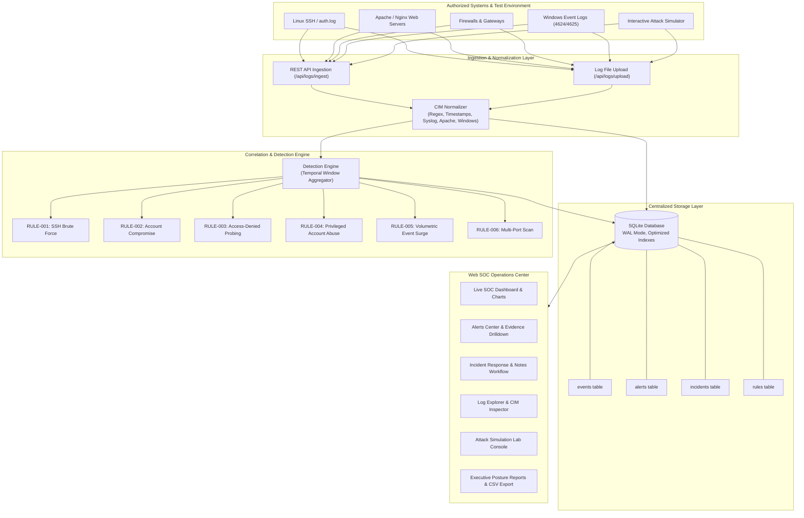

# Centralized Security Log Monitoring and Alert System (Mini-SIEM)

> **Cybersecurity Industrial Project**  
> A centralized, real-time security log ingestion, normalizer, correlation detection engine, and incident response platform designed for small and medium-sized organizations.

---

## 1. Executive Summary & Problem Solved

In modern enterprise infrastructures, servers, firewalls, web applications, databases, and workstations continuously generate vast volumes of disparate logs (Syslog, Linux Auth, Apache/Nginx, Windows Events). Checking these systems independently makes it difficult to detect coordinated attacks (e.g., repeated failed logins on one host followed by a successful login elsewhere). Normal logs also overwhelm administrators, masking critical indicators of compromise.

**This solution provides:**
1. **Centralized Log Ingestion**: Ingests logs from multiple heterogeneous systems or simulated test environments via REST API and file batch uploads.
2. **CIM Normalization Engine**: Translates various log formats into a unified **Common Information Model (CIM)**.
3. **State-Tracking Rule Engine**: Evaluates correlated multi-event patterns over time windows (e.g. brute force, privilege escalation, account takeover).
4. **Alerts & Incident Response Room**: Prioritizes alerts by severity (`CRITICAL`, `HIGH`, `MEDIUM`, `LOW`), auto-escalates critical threats, tracks analyst case notes, and records remediation workflows.
5. **Interactive Attack Simulator & Test Lab**: Built-in simulator with one-click scenarios replicating all required attack activities from the problem statement.
6. **Multi-Role Security Dashboard**: Role-tailored views for System Administrators, SOC Analysts, Network Administrators, and IT Support.

---

## 2. Architecture & Data Flow



---

## 3. Predefined Detection Rules Catalog

| Rule ID | Rule Name | Condition & Temporal Window | Severity | Action Triggered |
|---|---|---|---|---|
| **RULE-001** | **Multiple Failed Logins (Brute Force)** | $\ge 5$ `AUTH_FAILURE` events from same IP within 300s (5 min). | **HIGH** | Generates alert, correlates all matched attempt IDs. |
| **RULE-002** | **Success Immediately Following Failures** | $\ge 3$ `AUTH_FAILURE` immediately followed by `AUTH_SUCCESS` within 600s. | **CRITICAL** | Generates alert + **Auto-escalates to Formal Security Incident**. |
| **RULE-003** | **Repeated Access-Denied on Server** | $\ge 3$ `ACCESS_DENIED` (HTTP 403 / file forbidden) on same server within 180s. | **HIGH** | Flags directory enumeration / unauthorized probing. |
| **RULE-004** | **Unusual Privileged Account Activity** | Sensitive execution (`cat /etc/shadow`, `chmod 777`) by `root`/`admin`. | **CRITICAL** | Immediate alert + Incident creation. |
| **RULE-005** | **Sudden Surge in Security Events** | $\ge 20$ events from single source IP/host within 60s. | **MEDIUM** | Flags volumetric anomaly / automated scanner. |
| **RULE-006** | **Rapid Multi-Port Connection Probing** | Connections across $\ge 5$ distinct destination ports from single IP within 60s. | **MEDIUM** | Identifies reconnaissance / port scanning. |

---

## 4. Problem Statement Alignment Matrix

| Problem Statement Requirement | Implementation in System |
|---|---|
| **1. Logs stored on different machines** | Centralized SQLite database schema with unified Common Information Model (CIM). |
| **2. Normal logs hiding security events** | State-tracking rule engine filters out noise and extracts only actionable alerts. |
| **3. Repeated failed logins not noticed** | Real-time sliding-window counter triggers **RULE-001** and **RULE-002**. |
| **4. Group related events by user/IP** | Alert-event mapping table (`alert_events`) allows one-click deep-dive into all correlated logs. |
| **5. Prioritizing alerts for administrators** | Color-coded severity tiering (`CRITICAL`, `HIGH`, `MEDIUM`, `LOW`) and DEFCON threat posture indicator. |
| **6. Incident history and tracking** | Incident Management subsystem with status transitions (`OPEN` $\to$ `INVESTIGATING` $\to$ `CONTAINED` $\to$ `RESOLVED`), analyst notes timeline, and assigned investigators. |
| **7. Multi-user perspective** | Interactive Role Switcher: System Administrator, SOC Analyst, Network Administrator, IT Support Team. |
| **8. Authorized test environment only** | Built-in **Attack Simulation Lab** with test scenarios covering all 6 activities safely. |

---

## 5. How to Run the Server & Access the Application

### Prerequisites
- Python 3.10+ (Tested on Python 3.14 on Windows)
- Modern web browser (Chrome, Edge, Firefox)

### Step 1: Navigate to Project Directory
```powershell
cd "C:\Users\poloj\.gemini\antigravity\scratch\centralized_security_log_monitor"
```

### Step 2: Run Automated Unit Tests (Optional)
```powershell
python test_system.py
```
*(Runs 15 test cases validating normalization, rule detections, and incident workflow)*

### Step 3: Start the SIEM Server
```powershell
python run_server.py
```

### Step 4: Open the Web Application
Open your browser and navigate to:
```
http://127.0.0.1:8000/
```

---

## 6. Testing Demonstration Guide (Using Built-In Simulator)

Once the application is open in your browser:
1. Click the **🧪 Attack Simulation Lab** tab in the navigation menu.
2. Select any scenario:
   - **Test 1: Multiple Failed Logins** $\to$ Generates 6 failed SSH logins from `192.168.1.185`.
   - **Test 2: Account Takeover** $\to$ Simulates 4 failures followed by successful authentication for `finance_director`. Notice the system auto-escalates this to an Incident!
   - **Test 3: Access-Denied Probing** $\to$ Simulates rapid 403 Forbidden queries on protected salary and backup database endpoints.
   - **Test 4: Privileged Account Abuse** $\to$ Simulates root accessing `/etc/shadow`.
   - **Test 5: Event Surge** $\to$ Floods 25 packets in seconds.
   - **Test 6: Baseline Traffic** $\to$ Injects 15 legitimate logs (verifies zero false positives).
   - **Full Test Suite** $\to$ Runs all scenarios together.
3. Switch back to the **📊 SOC Dashboard** tab:
   - Observe live metric updates and real-time telemetry charts.
   - Click **🔍 Investigate** on any alert to view the correlated raw logs and metadata.
   - Click **🚨 Incidents** to review the investigation case timeline, assign an analyst, and post notes.
   - Click **📑 Executive Reports** to view and print the executive summary report.

---

## 7. Project File Structure

```
centralized_security_log_monitor/
├── app/
│   ├── __init__.py           # Package indicator
│   ├── config.py             # Server settings, paths, rule configurations
│   ├── database.py           # SQLite schema, indexes, connection context manager
│   ├── models.py             # Pydantic schemas for logs, alerts, incidents
│   ├── normalizer.py         # Multi-format CIM parser (Linux, Apache, Windows, Syslog)
│   ├── detection_engine.py   # Sliding-window temporal correlation engine
│   ├── incident_manager.py   # Incident workflow, notes timeline, and triage
│   ├── simulator.py          # Controlled security test attack generator
│   ├── api.py                # Starlette ASGI REST endpoints
│   └── static/
│       ├── index.html        # High-contrast Cyber SOC Dashboard SPA
│       ├── css/style.css     # Glassmorphic dark cyber theme
│       └── js/app.js         # Reactive UI, live polling, charts, modal controllers
├── data/
│   ├── sample_logs/          # Sample raw log files (auth.log, apache, sudo)
│   └── security_logs.db      # SQLite database
├── test_system.py            # Complete automated test suite (15 tests)
├── seed_demo_data.py         # Demo database seeder
├── run_server.py             # Application server launcher
└── README.md                 # Project documentation and user manual
```
